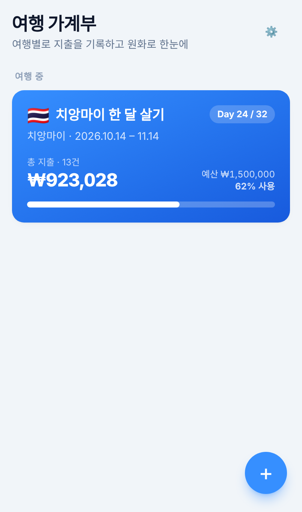
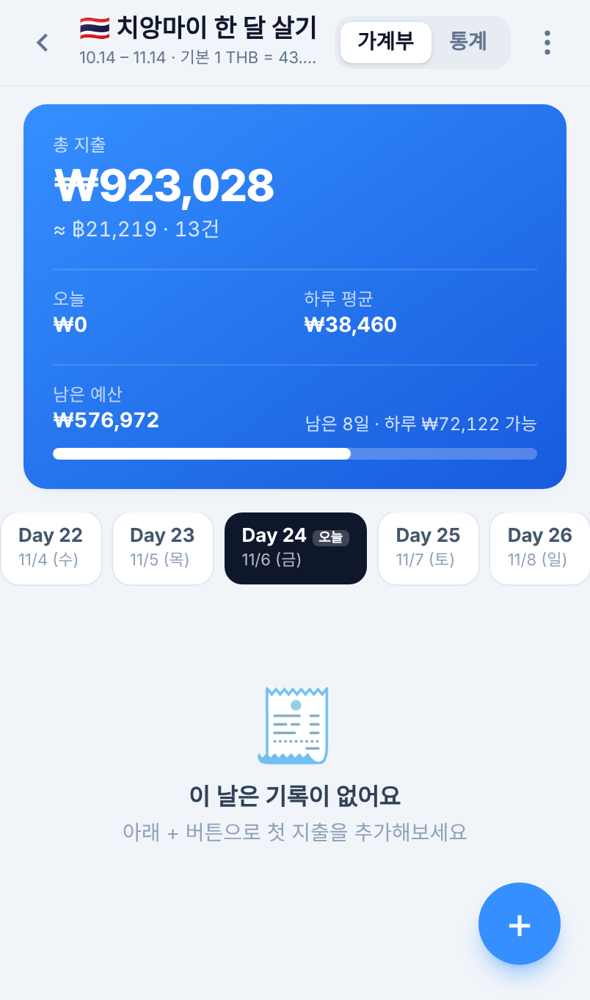
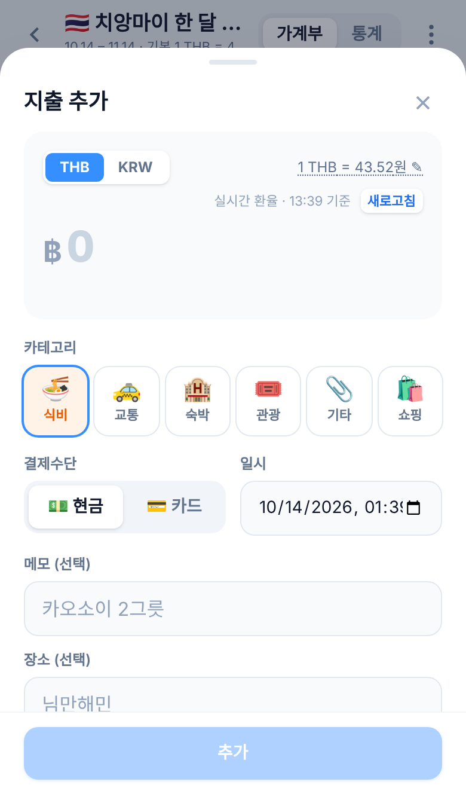
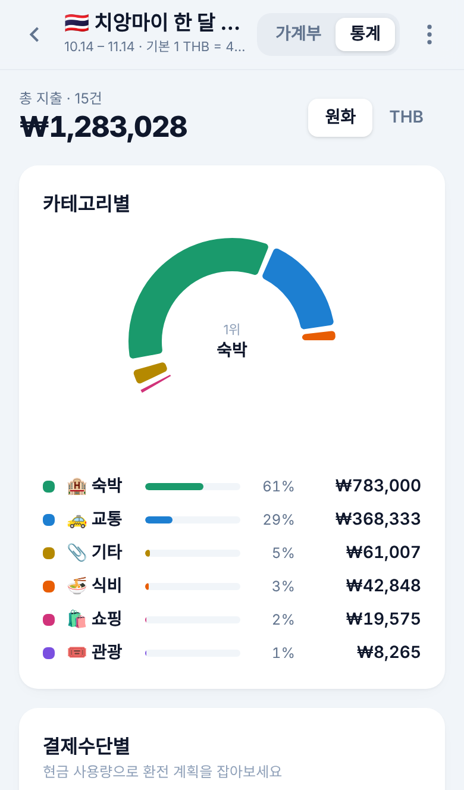
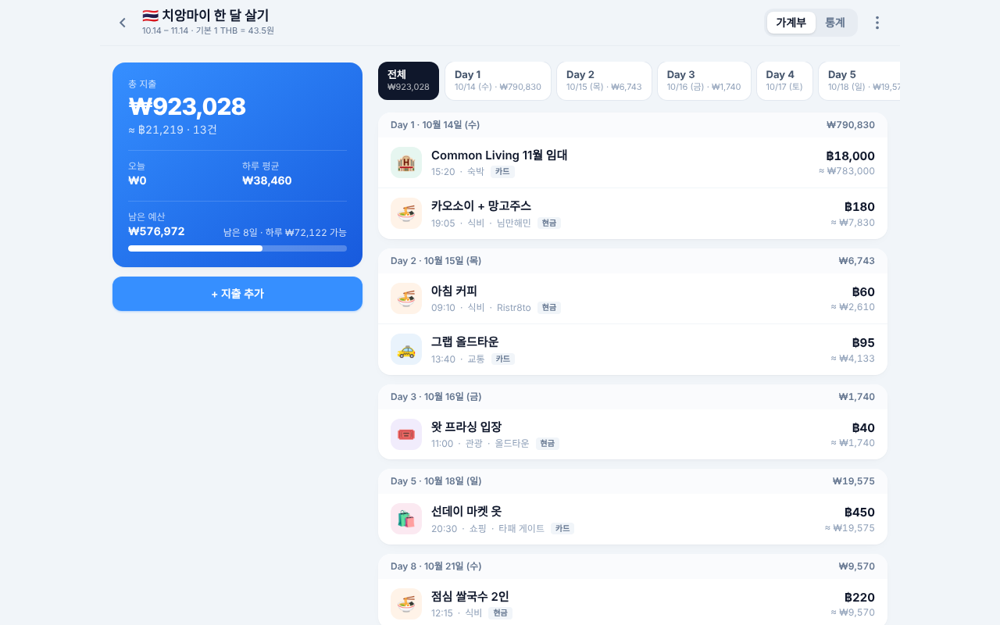
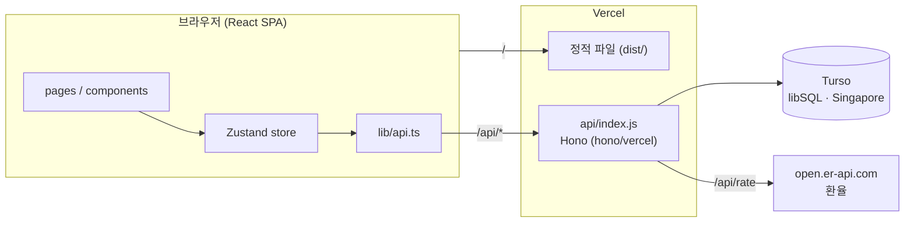

# 여행 가계부 — travel-ledger

여행 중 지출을 **현지 통화 또는 원화로** 기록하고, **저장 시점의 실시간 환율**로 환산해 한눈에 보여주는 반응형 웹앱입니다.
한 달 살기 중에 직접 쓰려고 만든 개인 프로젝트로, 폰 브라우저에서 바로 열어 쓰는 것을 전제로 설계했습니다.

**스택** React 19 · TypeScript · Vite · Tailwind CSS 4 · Zustand · Recharts / Hono · libSQL(Turso) / Vercel Serverless

| 여행 목록 | 가계부 | 지출 추가 | 통계 |
|---|---|---|---|
|  |  |  |  |

<details>
<summary>데스크톱 레이아웃</summary>


</details>

## 기능

- **여행 단위 가계부** — 국가/통화, 기간, 예산. 여행 중이면 `Day N / 전체일수`, 예정이면 `D-n` 표시
- **지출 기록** — 금액은 현지 통화(฿) 또는 원화(₩) 중 선택해 입력. 카테고리 6종(식비·교통·숙박·관광·기타·쇼핑), 현금/카드, 일시, 메모, 장소
- **환율** — 지출 추가 시 실시간 환율을 조회해 **그 지출에 함께 저장**하고 환산. 나중에 환율이 바뀌어도 과거 기록은 그대로. 직접 수정 가능하며, 조회 실패 시 여행에 설정한 기본 환율로 대체
- **날짜 탭** — `전체 | Day 1 | Day 2 …` 가로 탭, 오늘 탭 자동 포커스. 내역은 저장 순서대로, 각 줄에 저장 통화 + 반대 통화 환산값
- **요약 카드** — 총 지출, 오늘 지출, 하루 평균, 남은 예산과 "남은 n일 · 하루 ₩x 가능"
- **통계** — 카테고리 도넛 + 비율 리스트, 결제수단 비율(환전 계획용), 일별 막대와 일 예산선. 원화/현지통화 토글
- **백업** — JSON 내려받기/복원(병합 또는 교체), CSV 내려받기(엑셀·시트용), 여행 기본 환율로 일괄 재계산
- **계정** — 구글 로그인. 여행/지출은 소유자별로 완전히 분리되고 모든 쿼리에 소유자 조건이 붙음. `ALLOWED_EMAILS`로 특정 계정만 허용 가능(개인용) / 비우면 누구나 가입. 세션 토큰은 HMAC 서명이라 서버 세션 저장소 없음. 로컬 개발은 PIN 모드
- **모바일 대응** — iPhone Safari 기준으로 검증: 입력 시 자동 확대 방지, 노치/홈 인디케이터 safe-area, 키보드가 올라와도 바텀시트가 밀리지 않도록 visualViewport 기준 배치. 홈 화면에 추가하면 앱처럼 실행

## 아키텍처



- **프론트**는 정적 파일, **API**는 서버리스 함수 하나(`api/index.js`). 같은 Hono 앱(`server/app.js`)을 Node 서버(`server/index.js`)에서도 그대로 띄울 수 있어 로컬·Docker·VPS 배포도 동일 코드
- **DB**는 libSQL. `TURSO_DATABASE_URL`이 있으면 Turso 원격(fetch 기반 `@libsql/client/web` → 네이티브 바이너리 없이 서버리스 호환), 없으면 로컬 SQLite 파일
- 함수와 DB를 모두 싱가포르 리전에 두고, 지출 저장은 `INSERT … SELECT`로 여행 존재 확인과 삽입을 1회 왕복으로 처리

### 데이터 모델

```
users     id(google:<sub>), email, name, picture
trips     id, owner_id → users, title, country_code, city, start_date, end_date,
          local_currency, base_currency(KRW), exchange_rate(기본 환율), budget?
expenses  id, trip_id, amount_local, amount_base, currency(입력 통화),
          category, payment_method, exchange_rate(저장 시점 환율), memo, place, spent_at
```

`amount_base`(원화)는 저장 시점에 계산된 스냅샷이고 `exchange_rate`가 그 근거입니다. 합계·통계는 이 값을 그대로 더하므로 환율 변동과 무관하게 과거 기록이 흔들리지 않습니다.

## 로컬 실행

Node.js 20 이상.

```bash
npm install
npm run dev:server     # API — http://localhost:3000 (PIN 1234, 로컬 SQLite ./data/ledger.sqlite)
npm run dev            # 프론트 — http://localhost:5173 (/api 는 3000으로 프록시)
```

프로덕션처럼 한 프로세스로:

```bash
npm run build && APP_PIN=1234 npm start   # http://localhost:3000
```

샘플 데이터:

```bash
npm run seed              # 치앙마이 여행 1개
npm run seed -- --demo    # + 데모 지출 13건
```

## 환경변수

| 변수 | 설명 |
|---|---|
| `GOOGLE_CLIENT_ID` | 구글 OAuth 클라이언트 ID. 설정하면 구글 로그인 모드 |
| `ALLOWED_EMAILS` | 로그인 허용 이메일(쉼표 구분). 비우면 누구나 가입 |
| `APP_PIN` | `GOOGLE_CLIENT_ID` 없을 때 PIN 모드 (로컬 개발용) |
| `APP_SECRET` | 세션 토큰 서명 키 (긴 랜덤 문자열) |
| `TURSO_DATABASE_URL` | `libsql://…turso.io` — 설정 시 Turso 사용 |
| `TURSO_AUTH_TOKEN` | Turso 토큰 |
| `DB_PATH` | Turso 미설정 시 로컬 SQLite 경로 (기본 `./data/ledger.sqlite`) |
| `PORT` | Node 서버 포트 (기본 3000) |

`.env.example` 참고.

## 배포

### Vercel + Turso (현재 운영, 무료)

1. Vercel에서 이 레포 Import — `vercel.json`이 빌드/라우팅/리전(`sin1`)을 정의
2. **Storage → Turso → Create / Connect** (환경변수 prefix `TURSO`) → `TURSO_DATABASE_URL`, `TURSO_AUTH_TOKEN` 자동 주입
3. `GOOGLE_CLIENT_ID`, `ALLOWED_EMAILS`(선택), `APP_SECRET` 추가 → Deploy

구글 OAuth 클라이언트는 [Google Cloud Console → APIs & Services → Credentials](https://console.cloud.google.com/apis/credentials)에서 **Web application** 타입으로 만들고, Authorized JavaScript origins에 배포 도메인과 `http://localhost:5173`을 등록합니다. 클라이언트 시크릿은 필요 없습니다(ID 토큰 흐름).

`main` 푸시마다 자동 배포. Hobby 플랜은 커밋 작성자가 Vercel 계정과 같은 GitHub 계정이어야 배포됩니다.

### 그 외

- **Docker** — `docker build -t travel-ledger . && docker run -p 3000:3000 -e APP_PIN=… -v ledger-data:/data travel-ledger` (`/data`에 SQLite 저장)
- **Render** — `render.yaml` 블루프린트 포함. 무료 인스턴스는 유휴 시 잠들고 디스크가 휘발성이라 Turso 연결 필수
- **Node 직접** — `npm ci && npm run build && APP_PIN=… npm start`, HTTPS는 리버스 프록시에서

## API

모든 `/api/*`는 `Authorization: Bearer <token>` (PIN 미설정 시 생략 가능).

```
GET    /api/auth/status             { mode: google|pin|none, googleClientId? }
POST   /api/auth/google             { credential } → { token, user }   구글 ID 토큰 검증
POST   /api/auth/login              { pin } → { token, user }          PIN 모드
GET    /api/auth/me

GET    /api/trips                   목록 (+ totalBase, expenseCount)
POST   /api/trips
GET    /api/trips/:id
PUT    /api/trips/:id
DELETE /api/trips/:id               지출 포함 삭제
POST   /api/trips/:id/recalc        여행 기본 환율로 지출 전체 재계산
GET    /api/trips/:id/expenses

POST   /api/expenses                { tripId, amountLocal, amountBase, currency, category,
                                      paymentMethod, exchangeRate?, memo?, place?, spentAt }
PUT    /api/expenses/:id
DELETE /api/expenses/:id

GET    /api/export                  전체 JSON
POST   /api/import?replace=0|1      JSON 복원 (병합 / 교체)
GET    /api/rate?from=THB&to=KRW    실시간 환율 (open.er-api.com 프록시)
GET    /healthz
```

## 프로젝트 구조

```
api/index.js          Vercel 서버리스 진입점 (hono/vercel, 메서드별 export)
server/app.js         Hono 앱 — 라우트, 검증 (Node/Vercel 공용)
server/auth.js        구글 ID 토큰 검증, PIN, 세션 토큰 서명/검증
server/index.js       Node 서버 — app + dist/ 정적 서빙
server/db.js          libSQL 저장 레이어, 스키마/마이그레이션
server/seed.js        샘플 데이터
src/
  pages/              TripsPage · LedgerPage · StatsPage · SettingsPage · LoginPage
  components/         ui(Sheet·Button…) · ExpenseForm · TripForm · TripHeader
  store/useStore.ts   Zustand — 인증, 여행/지출 상태, 토스트
  lib/                api(fetch 래퍼) · rate(실시간 환율+캐시) · router(hash) · format(금액·날짜)
  types.ts            도메인 타입, 카테고리/통화 메타
docs/screenshots/
vercel.json · render.yaml · Dockerfile
```

## 설계 메모

- **왜 지출별 환율인가** — 한 달 체류 중 환율이 수 % 움직이는데 여행 단위 고정 환율은 실제 결제액과 어긋남. 저장 시점 환율을 지출에 박아두면 "그때 얼마였나"가 보존되고, 통계도 재계산 없이 합산만 하면 됨
- **왜 서버리스 + Turso인가** — 브라우저 저장(IndexedDB)은 iOS가 임의로 지울 수 있어 탈락. 항상 켜진 서버는 비용이 들거나(Railway) 무료 티어가 잠듦(Render). Vercel 함수 + Turso 조합은 무료이면서 잠들지 않고, 둘 다 싱가포르에 둘 수 있음
- **카테고리 색** — 6색을 색각 이상(CVD) 분리 검증을 통과한 고정 순서로 사용. 차트에서 색만으로 구분되지 않도록 범례·라벨 병기

## 로드맵

- [ ] 동행인 초대 + 정산(N빵)
- [ ] 영수증 사진 첨부
- [ ] 백엔드를 Spring Boot로 교체해보기
