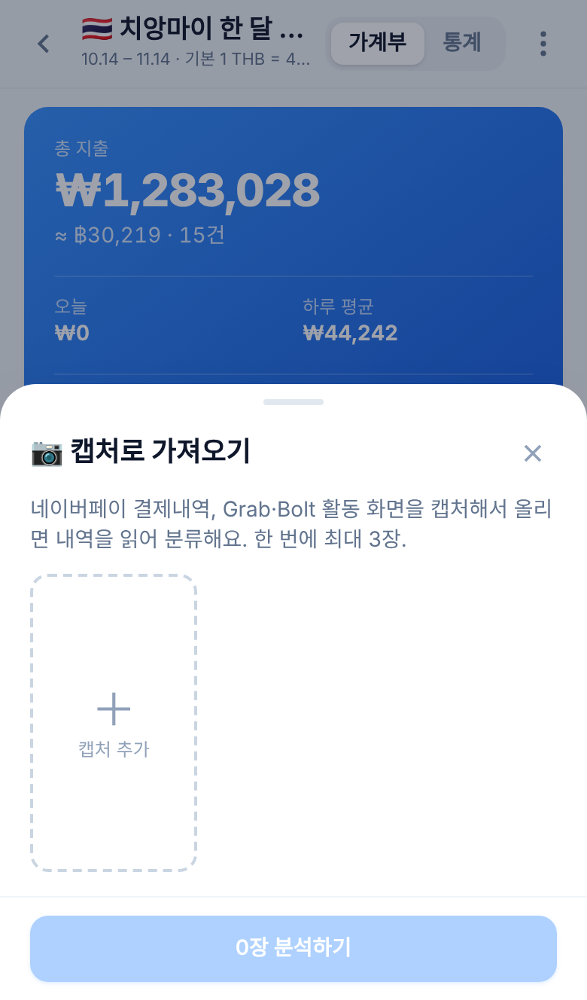

# 여행 가계부 (travel-ledger)

여행 중 지출을 현지 통화나 원화로 기록하고, 저장 시점의 환율로 환산해 보여주는 반응형 웹앱입니다. 폰 브라우저에서 바로 열어 쓰도록 만들었습니다.

**데모: https://travel-ledger-app.vercel.app** (구글 계정으로 로그인)

| 가계부 | 지출 추가 | 캡처로 가져오기 | 통계 |
|---|---|---|---|
|  |  |  |  |

## 주요 기능

- **여행별 가계부**: 기간, 통화, 예산을 정하고 날짜 탭(`전체 · 여행준비 · Day 1 …`)으로 지출을 봅니다.
- **지출 기록**: 현지 통화 또는 원화로 입력하고, 카테고리·결제수단·메모·장소를 남깁니다.
- **환율**: 지출을 저장할 때의 실시간 환율을 지출마다 함께 저장하므로, 이후 환율이 바뀌어도 과거 기록은 그대로입니다.
- **통계**: 카테고리별·결제수단별·일별 지출과 남은 예산을 보여줍니다.
- **캡처로 가져오기**: 네이버페이·Grab·Bolt 결제내역 스크린샷을 올리면 Gemini가 거래를 읽어 분류하고, 확인한 것만 저장합니다. 운영자가 허용한 계정에서만 쓸 수 있습니다.
- **엑셀 가져오기**: 다른 가계부에서 내보낸 `.xlsx`를 여행 단위로 가져옵니다.
- **백업**: JSON·CSV 내려받기와 JSON 복원을 지원합니다.
- **계정**: 구글 로그인을 쓰며, 데이터는 계정별로 분리됩니다.

## 기술 스택

| 영역 | 사용 기술 |
|---|---|
| 프론트엔드 | React 19, TypeScript, Vite, Tailwind CSS 4, Zustand, Recharts |
| 백엔드 | Hono (Vercel 서버리스 함수 / Node 서버 공용) |
| 데이터베이스 | libSQL (운영은 Turso, 로컬은 SQLite 파일) |
| 외부 서비스 | Google Identity Services, Gemini API, open.er-api.com(환율) |

## 시작하기

Node.js 20 이상이 필요합니다.

```bash
npm install
npm run dev:server     # API: http://localhost:3000 (PIN 1234, 로컬 SQLite)
npm run dev            # 프론트: http://localhost:5173
```

샘플 데이터를 넣으려면 `npm run seed -- --demo`를 실행합니다.

## 환경변수

로컬에서는 설정 없이 PIN 모드로 동작합니다. 전체 목록은 `.env.example`에 있습니다.

| 변수 | 설명 |
|---|---|
| `GOOGLE_CLIENT_ID` | 구글 OAuth 클라이언트 ID. 설정하면 구글 로그인을 사용 |
| `APP_SECRET` | 세션 토큰 서명 키 |
| `TURSO_DATABASE_URL`, `TURSO_AUTH_TOKEN` | Turso 연결 정보. 없으면 로컬 SQLite 사용 |
| `ALLOWED_EMAILS` | 로그인을 허용할 이메일(쉼표 구분). 비우면 누구나 가입 |
| `GEMINI_API_KEY` | 캡처로 가져오기용 키. 없으면 기능이 숨겨짐 |
| `IMPORT_ALLOWED_EMAILS` | 캡처로 가져오기를 허용할 이메일(쉼표 구분) |

## 배포

Vercel과 Turso의 무료 플랜으로 운영 중입니다.

1. Vercel에서 이 레포를 Import합니다. 빌드와 라우팅은 `vercel.json`에 정의되어 있습니다.
2. Vercel Storage에서 Turso 데이터베이스를 연결합니다(환경변수 prefix `TURSO`).
3. `GOOGLE_CLIENT_ID`와 `APP_SECRET`을 추가하고 배포합니다.

구글 OAuth 클라이언트는 Google Cloud Console에서 Web application 타입으로 만들고, Authorized JavaScript origins에 배포 도메인을 등록합니다.

## 프로젝트 구조

```
api/index.js     Vercel 서버리스 진입점
server/          Hono 앱(app.js), 인증(auth.js), DB(db.js), 캡처 분석(vision.js)
src/pages/       여행 목록, 가계부, 통계, 설정, 로그인
src/components/  지출 폼, 가져오기 시트, 공용 UI
src/lib/         API 클라이언트, 환율, 엑셀 파싱, 포맷
```

## 라이선스

[MIT](LICENSE)
